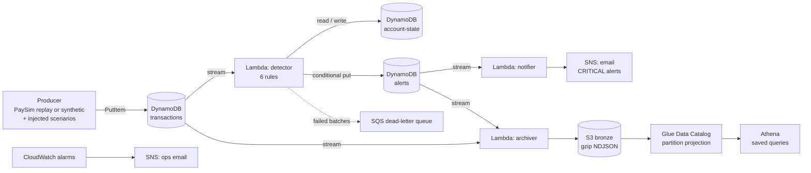
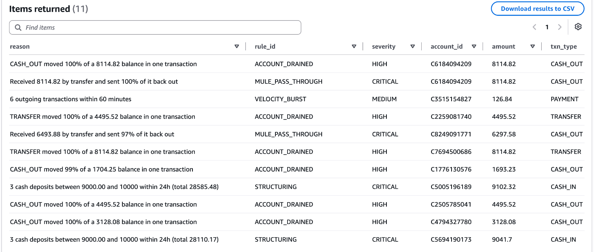
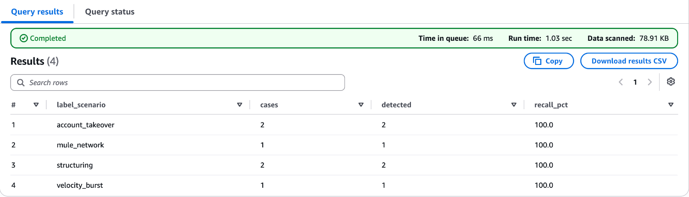
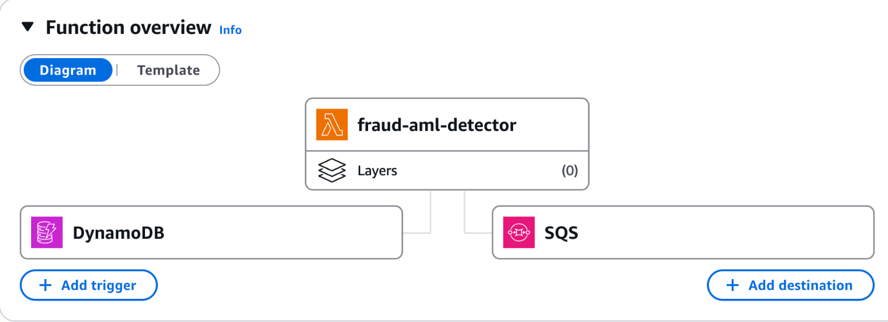
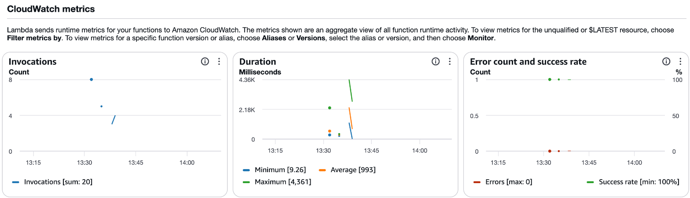
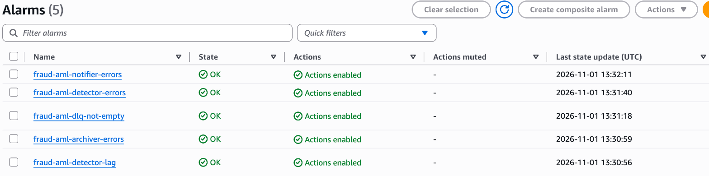
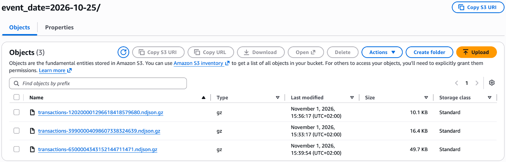
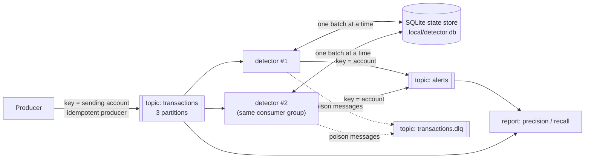

# Real-time Fraud & AML Detection on AWS (free tier)

A streaming pipeline that screens mobile-money transactions for fraud and money laundering as they
happen, stores alerts for investigators, emails the serious ones, and lands everything in a data
lake for analysis. It is fully serverless, built with Terraform, and designed to cost **$0/month**
on the AWS free tier.

It runs on [PaySim](https://www.kaggle.com/datasets/ealaxi/paysim1) (synthetic mobile-money data
modelled on a real African mobile-money service) or on a built-in synthetic population. Known fraud
and AML scenarios are injected with ground-truth labels, so **detection quality is measured, not
guessed**.

**Highlights**

- **Real time:** DynamoDB Streams trigger Lambda within seconds of each transaction.
- **6 detection rules** covering fraud *and* AML typologies: account takeover, structuring
  (smurfing), mule accounts, velocity bursts, amount spikes, high-value transfers.
- **Stateful stream processing:** per-account sliding windows on *event time*, with cool-downs.
- **Effectively-once results** on an at-least-once stream: de-duplication, idempotent alert writes,
  and optimistic locking.
- **Measured quality:** precision per rule and recall per scenario against labelled data.
- **Finance-grade details:** money is always `Decimal`, never float. The raw data is append-only,
  every row carries lineage columns, and there is a dead-letter queue for failed batches.
- **Production hygiene:** least-privilege IAM per function, encryption, TLS-only buckets,
  CloudWatch alarms, a cost budget, and CI with tests, lint and `terraform validate`.
- **Two transports, one engine:** DynamoDB Streams on AWS for $0, or **Apache Kafka** locally in
  Docker, with consumer groups, manual offset commits, a dead-letter topic and an idempotent producer.
- **Runs on a laptop:** `make demo` runs the whole detection pipeline locally with no AWS account.

## Architecture



| Component | Role |
|---|---|
| `producer` (runs on your laptop) | Replays PaySim or simulates 3,000 customers, injects labelled scenarios, writes to DynamoDB at a capped rate |
| `transactions` table + stream | Short-lived ingestion buffer (7-day TTL). Its change stream is the event bus |
| `detector` Lambda | Runs the rules against each account's recent history and writes alerts |
| `account-state` table | One small item per account: a 24h event window, lifetime spending baseline, and cool-downs |
| `alerts` table + stream | Alerts keyed by account and time, so you can look up an account's alert history in one query |
| `notifier` Lambda | Emails CRITICAL alerts. It reads the alerts *stream*, so it only announces alerts that were stored |
| `archiver` Lambda | Copies both streams to S3 as gzip NDJSON, partitioned by event date |
| Glue + Athena | SQL over the lake with no crawlers; four saved queries for investigation and evaluation |

## Detection rules

| Rule | Typology | Fires when | Severity |
|---|---|---|---|
| `ACCOUNT_DRAINED` | Account takeover | A TRANSFER or CASH_OUT moves at least 99% of a balance of 1,000 or more | HIGH |
| `HIGH_VALUE_TRANSFER` | Large-value reporting | A single transfer of 200,000 or more | MEDIUM |
| `VELOCITY_BURST` | Compromised account | 6 or more outgoing transactions within 60 minutes | MEDIUM |
| `STRUCTURING` | Smurfing (AML) | 3 or more cash deposits between 9,000 and 9,999.99 within 24h | CRITICAL |
| `MULE_PASS_THROUGH` | Money mule (AML) | 80% or more of the transfers received within 24h (at least 5,000) is sent back out | CRITICAL |
| `AMOUNT_SPIKE` | Unusual behaviour | An outgoing amount at least 10x the customer's own average (needs 5 or more past transactions) | MEDIUM |

Every threshold is configurable without a code change. Locally, use `--rule-overrides '{"velocity_min_count": 8}'`.
On AWS, set `rule_overrides` in `terraform.tfvars`. The code is in
[`src/fraud_aml/rules.py`](src/fraud_aml/rules.py) and the defaults are in
[`config.py`](src/fraud_aml/config.py).

## Data and ground truth

| Source | What it is |
|---|---|
| Synthetic (default) | 3,000 customers with personal spending levels, about 3 transactions per customer per day, and a PaySim-like mix of transaction types. 1% of legitimate cash-outs empty the account, which creates realistic false positives |
| PaySim | 6.3M rows. Its `isFraud` rows become the `paysim_fraud` label. See [`data/README.md`](data/README.md) |

The producer injects four scenarios on top of either source, at a configurable rate:

| Scenario | What happens |
|---|---|
| `account_takeover` | A victim's whole balance is transferred to a new mule account, which cashes out minutes later |
| `structuring` | 3-5 cash deposits of 9,000-9,990 over a few hours |
| `mule_network` | 2-4 senders pay a mule, which cashes out 93-100% within about 2 hours |
| `velocity_burst` | 6-10 payments and cash-outs from one account within 30 minutes |

Each transaction carries `label_suspicious`, `label_scenario` and `label_scenario_id`. The detector
**cannot see these labels**: `Transaction.from_record` drops them, and a test checks that it does.
In real life, labels arrive weeks later from chargebacks and investigations; here they let us
score the rules.

## Results

From `make demo`: about 20,000 synthetic transactions, 80 injected scenarios, random seed 42. It runs in under a second.

| Rule | Alerts | True positives | Precision |
|---|---:|---:|---:|
| ACCOUNT_DRAINED | 119 | 44 | 37.0% |
| AMOUNT_SPIKE | 12 | 2 | 16.7% |
| MULE_PASS_THROUGH | 34 | 32 | 94.1% |
| STRUCTURING | 20 | 20 | 100.0% |
| VELOCITY_BURST | 20 | 20 | 100.0% |

| Scenario | Cases | Detected | Recall |
|---|---:|---:|---:|
| account_takeover | 20 | 20 | 100% |
| mule_network | 20 | 20 | 100% |
| structuring | 20 | 20 | 100% |
| velocity_burst | 20 | 20 | 100% |

**Live run on AWS** (eu-north-1, November 2026): 621 transactions streamed through the deployed
pipeline (DynamoDB Streams, then Lambda, then S3, then Athena). Every injected case was detected
(2 account takeovers, 2 structuring, 1 mule network and 1 velocity burst), with 0 Lambda errors and
an empty dead-letter queue. The saved Athena queries produced these numbers from the S3 data lake,
scanning about 30 KB each.

**Reading the numbers**

- Recall is measured **per case**: a scenario counts as caught if any of its transactions raised
  an alert, because one good alert opens the whole investigation. Transaction-level recall is lower
  (27.5%) by design, since a rule flags the transaction that completes a pattern, not every step.
- `ACCOUNT_DRAINED` produces most of the false positives, because legitimate customers also empty
  their accounts. This is the classic **precision vs recall trade-off**. Raising
  `drain_min_balance` from 1,000 to 5,000 cuts its false positives from 75 to 31 (precision 37% →
  47%), but account-takeover recall drops from 100% to 60%. For fraud, missing a takeover usually
  costs more than reviewing a false alarm, so the lower threshold is the default.
- `HIGH_VALUE_TRANSFER` never fires on the synthetic data (no transfers that large). It exists for
  PaySim, which has many.

## Screenshots from the live AWS deployment

**Alerts raised by the detector** (DynamoDB, queried with PartiQL): each alert has its rule, severity and a readable reason.



**Detection quality measured in Athena** (the saved `scenario_recall` query, run over the S3 data lake): every injected case was caught, after scanning only 79 KB.



**The detector Lambda:** it's triggered by the DynamoDB stream, with an SQS dead-letter queue for failed batches. It had 20 invocations, 0 errors and a 100% success rate.




**Pipeline health:** five CloudWatch alarms (Lambda errors, stream lag, dead-letter queue), all OK.



**The bronze layer in S3:** gzipped NDJSON batches under `bronze/transactions/event_date=YYYY-MM-DD/`, the layout Athena's partition projection reads.



## Design decisions

**DynamoDB Streams instead of Kinesis or Kafka.** Kinesis bills for every hour a shard exists, and
MSK (managed Kafka) costs far more, so neither is free. DynamoDB Streams give ordered change data
capture per item, and Lambda reads them at no charge. The trade-off is lower throughput and only
two consumers per stream, which is fine at this scale. The detector code doesn't depend on the
transport: it processes a list of transactions. That is why the same engine also runs on Kafka
(see [Kafka mode](#kafka-mode-local-free)).

**Event time, not processing time.** Windows use the transaction's own timestamp. Each batch is
sorted by event time, because records from different shards are not globally ordered. The producer
runs a simulated clock, so at the default 5 transactions per second a full day of customer
behaviour passes in about 30 minutes.

**Bounded, sliding per-account state.** Each account keeps its last 24h of events (at most 40) in
one DynamoDB item, usually under 1 KB, which costs 1 write unit. Sliding windows avoid the edge
effects of fixed calendar windows. For example, structuring that spans midnight is still caught.

**Out-of-order events across partitions (found by testing on real Kafka).** Transactions are keyed
by the sending account, so each account's own transactions stay in order. But a mule's *incoming*
transfers are keyed by their senders, and travel on other partitions. When a backlog was replayed,
the first real-broker run caught only 75% of mule networks: Kafka handed over partitions in large
chunks, so a mule's cash-out was often processed before the transfers that funded it. One partition
could also run 20+ simulated hours ahead, and its "future" events pruned other accounts' cool-downs
early, which caused duplicate alerts. Three fixes brought Kafka to the same results as the
in-process run:
1. **Order-insensitive rules.** The mule rule is also checked when a *late* inbound transfer
   arrives (`mule_pass_through_late_inflow`).
2. **Allowed lateness.** State and cool-downs are kept for the window plus 6 hours, so events up
   to 6 hours late are still evaluated correctly.
3. **Bounded skew.** The consumer fetches small chunks per partition, keeping partitions close in
   event time. This is a lightweight form of the watermark alignment that Flink does.

The DynamoDB pipeline benefits too: its shards aren't ordered across items either.

**Effectively-once on an at-least-once stream.**
1. The account state records which transactions it has applied, so re-delivered records are skipped.
2. Alert keys are deterministic (`event_ts#rule#txn_id`) and written with `attribute_not_exists`,
   so retries never create duplicates.
3. Alerts are written *before* state, so a crash between the two is repaired by the retry.
4. State writes use a version number (optimistic locking). On a conflict, the batch is re-evaluated
   against fresh state.

**Notifications through change data capture.** The notifier reacts to the alerts table's own
stream (the transactional-outbox pattern), so an email is never sent for an alert that failed to
save. Alerts in one batch are grouped into one email to stay under SNS's 1,000 free emails a month.

**Failure handling.** Malformed records are logged and skipped, so a bad record can't block its
shard. A failing batch is split in half to isolate the bad record (`bisect_batch_on_function_error`),
retried 3 times, and then its location goes to an SQS dead-letter queue, which triggers an alarm.
Stream lag (`IteratorAge`) also has an alarm, because it is the key health metric for any stream
consumer.

**Triggers start from the oldest record (found on the first real deploy).** The first deploy used
`starting_position = LATEST`, and about 300 of the first 621 transactions were silently skipped
by both the detector and the archiver: a new trigger takes about a minute to start polling, and
LATEST ignores anything written before that. The triggers now use `TRIM_HORIZON`, which re-reads
the stream's 24-hour history. That is safe here only because every consumer is idempotent, and it
recovered the 300 missed transactions without re-sending anything.

**Money handling.** Amounts are `Decimal` end to end and stored as DynamoDB numbers, which are
exact. In S3 they are written as fixed-point strings, so no JSON reader can turn them into floats.
Queries use `CAST(amount AS DECIMAL(18,2))`.

**A lake without crawlers.** The S3 layout is `bronze/<entity>/event_date=YYYY-MM-DD/`. Glue
*partition projection* works out the partitions from that template, so no crawler is needed and
Athena only reads the days you filter on. Bronze is raw and append-only. Duplicates from retries
are removed in queries, and later in a silver layer.

**Security.** Each function has its own IAM role, limited to specific tables, streams, S3 prefixes
and log groups. Buckets block public access, use SSE-S3 encryption and deny non-TLS requests. There
is no VPC, so there is no NAT gateway (about $32/month). The Lambda zip is 20 KB with no
third-party dependencies, so there is nothing to patch.

## Cost

| Service | Usage | Free tier | Expected cost |
|---|---|---|---|
| DynamoDB (provisioned) | 3 tables, 12 read / 24 write capacity units in total | 25 RCU + 25 WCU + 25 GB, always free | $0 |
| DynamoDB Streams | Read by Lambda | Free when read by Lambda | $0 |
| Lambda | Thousands of invocations per demo, 128-256 MB, arm64 | 1M requests + 400k GB-seconds per month | $0 |
| S3 | A few MB of gzip | Fractions of a cent per GB | ~$0.00 |
| Athena | $5 per TB scanned, 10 MB minimum per query | Each query capped at 1 GB by the workgroup | ~$0.00 |
| Glue Data Catalog | 1 database, 2 tables | 1M objects free | $0 |
| SNS / SQS / CloudWatch | <1,000 emails, 5 alarms, 14-day log retention | 1,000 emails, 1M requests, 10 alarms, 5 GB logs | $0 |

`terraform validate` checks that the provisioned capacity stays at or below 25 read and 25 write
units. Prefer paying per request? Set `dynamodb_billing_mode = "PAY_PER_REQUEST"`. It costs nothing
while idle and fractions of a cent per demo run. AWS changes its free tier from time to time, so
check the [current terms](https://aws.amazon.com/free/) for your account. Accounts created after
July 2025 get a credit-based free plan.

## Getting started

### 1. Prerequisites (macOS)

```bash
brew install python@3.13 awscli hashicorp/tap/terraform
```

Terraform comes from HashiCorp's own Homebrew tap, because the default Homebrew formula is outdated.
For the optional [Kafka mode](#kafka-mode-local-free) you also need Docker: install
[Docker Desktop](https://www.docker.com/products/docker-desktop/) (free for personal use). A
lighter alternative is Colima: `brew install colima docker docker-compose`, follow Homebrew's note
on enabling `docker compose`, then run `colima start`.

### 2. Run it locally (no AWS account needed)

```bash
make setup      # creates .venv with Python 3.13 and installs the dev tools
make test       # 57 tests, including DynamoDB integration tests against a local mock (moto)
make demo       # whole pipeline in-process, then prints the quality report
```

`make demo-paysim` does the same on PaySim once you have downloaded it (see [data/README.md](data/README.md)).

### 3. Make your AWS account safe and connect the CLI (one time)

**Accounts from AWS's new sign-up** (the console shows *AWS Settings* and "projects"): there is no
root user or IAM console user. Do **not** "activate advanced features": it can't be undone and
needs the Paid plan. Instead:
1. Turn on MFA for the login you signed up with: your Google, Apple, GitHub or Amazon account,
   or **https://settings.aws.com**, then *Manage security and sign-in*.
2. Run `aws login` and `aws configure set region <your region>`. The region is required: the
   temporary credentials refresh every few minutes, and the refresh needs it. Set `aws_region` in
   `terraform.tfvars` to the same region. This project uses only services that are allowed on the
   free tier of these accounts.

**Classic accounts** (with a root user): turn on MFA for root and stop using it, create an admin
in **IAM Identity Center** and run `aws configure sso`, then create a **Zero spend budget** in
*Billing → Budgets*.

Either way, Terraform also creates a $1 guardrail budget once you set `alert_email`. It counts
usage *before* credits.

### 4. Deploy

```bash
cp infra/terraform/terraform.tfvars.example infra/terraform/terraform.tfvars   # set alert_email
make tf-init
make plan       # review what will be created (about 50 resources)
make deploy
```

If you use a named AWS profile, run `export AWS_PROFILE=<name>` first. AWS will send two
subscription emails (fraud alerts and ops). Click the link in each to confirm.

If the first `make deploy` fails with a permissions error on an event source mapping, run it again.
New IAM roles take a few seconds to reach every AWS service.

### 5. Stream transactions

```bash
make produce                     # 3,000 transactions at 5/second, about 10 minutes
make produce LIMIT=600 RATE=2    # a shorter run
```

While it runs:
- **CloudWatch → Log groups → `/aws/lambda/fraud-aml-detector`**: one JSON summary per batch.
- **DynamoDB → `fraud-aml-alerts` → Explore items**: alerts appear within seconds.
- **Your inbox**: one email per batch that contains a CRITICAL alert.
- **S3 → `fraud-aml-lake-…/bronze/`**: new files about once a minute.

### 6. Query in Athena

Open Athena, select the **`fraud-aml`** workgroup, and open **Saved queries**:

| Query | Answers |
|---|---|
| `rule_precision` | How accurate is each rule? |
| `scenario_recall` | Which typologies are we catching? |
| `investigation_queue` | Which accounts should an analyst look at first? |
| `hourly_volume` | What does the traffic look like? (shows partition pruning) |

### 7. Tear it down

```bash
make destroy
```

Everything is in Terraform, so `make deploy` rebuilds the pipeline in a few minutes whenever you
need it for a demo or an interview.

## Kafka mode (local, free)

The same detection engine, with **Apache Kafka** as the transport, running on your laptop. Nothing
is deployed to AWS.



```bash
make kafka-up         # Kafka 4.3 (KRaft, no ZooKeeper) + Kafka UI at http://localhost:8080
make kafka-detect     # terminal 1: the detector joins consumer group "fraud-aml-detector"
make kafka-produce    # terminal 2: 20,000 transactions at 500/second
make kafka-report     # score every alert in the topic against the ground truth
make kafka-down       # stop Kafka and delete its data
```

Things to try:
- **Scale out:** run `make kafka-detect` in a second terminal. The group rebalances, and each
  detector prints the partitions it now owns.
- **Kill a detector** with Ctrl+C mid-stream and start it again. It resumes from the last
  committed offset, and the alert counts don't change.
- **Open Kafka UI** to browse messages, see consumer-group lag, and inspect the dead-letter topic.

How it works:

| Concern | How it's handled |
|---|---|
| Ordering | Messages are keyed by sending account, so each account's transactions stay in order within one partition |
| Delivery | Offsets are committed manually, only after a batch's alerts are confirmed by the broker (at least once) |
| Duplicates | The idempotent producer prevents duplicates from producer retries. Re-read transactions are skipped by the state store, and alerts have deterministic keys |
| Poison messages | Malformed messages go to `transactions.dlq`, with the error and the source offset in the headers |
| State | A SQLite file plays the role of a Kafka Streams state store, so state survives restarts. Detectors in one group take turns writing whole batches. Optimistic locking alone livelocked under constant contention (found by testing) |
| Topics | Defined in code (`fraud_aml/kafka/common.py`) and created by `python -m fraud_aml.kafka.topics`. Auto-creation is switched off |
| Quality gate | CI starts a real Kafka broker, runs the whole flow, and fails if any scenario's recall drops below 90% (`kafka-report --min-recall 0.9`) |

Why not Kafka transactions (exactly-once semantics)? They only cover state kept inside Kafka. This
detector's state lives in an external store, so idempotent processing is the honest guarantee.
Running the same seed twice replays the same transaction ids (and they are de-duplicated); use
`make kafka-produce SEED=7` for new data.

## Project structure

```
├── src/fraud_aml/
│   ├── models.py            Transaction, Alert, GroundTruth; Decimal money helpers
│   ├── config.py            RuleConfig: every threshold, overridable via JSON
│   ├── rules.py             the six detection rules
│   ├── state.py             per-account sliding-window state
│   ├── engine.py            batch engine: ordering, de-duplication, idempotency, conflict retry
│   ├── stores.py            DynamoDB and in-memory state/alert stores
│   ├── ddb_stream.py        DynamoDB Streams record decoding
│   ├── evaluation.py        precision and recall against ground truth
│   ├── handlers/            Lambda entry points: detector, archiver, notifier
│   ├── kafka/               Kafka mode: topics, detector consumer, evaluation report
│   ├── sqlite_store.py      local state store for Kafka mode
│   └── producer/            simulator: world, baseline sources, scenarios, stream merge, CLI
├── tests/                   unit tests, DynamoDB (moto) and Kafka (fakes) tests, PaySim fixture
├── infra/terraform/         DynamoDB, Lambda, IAM, S3, Glue, Athena, SNS, SQS, alarms, budget
├── sql/                     Athena saved queries (deployed by Terraform)
├── compose.yaml             local Kafka broker + Kafka UI
├── data/                    put PaySim here (git-ignored)
└── .github/workflows/ci.yml lint, tests, quality gates, terraform validate, Kafka end-to-end
```

## Roadmap

- [ ] **Silver and gold layers with dbt-athena on Apache Iceberg:** de-duplicate bronze, compact
      small files, and build customer risk features and alert-to-case tables.
- [ ] **Streamlit dashboard:** an alert feed, the investigation queue, and rule-quality trends.
- [ ] **Deploy from GitHub Actions with OIDC** (no stored AWS keys), with remote Terraform state in S3.
- [ ] **Case management:** group alerts per account into cases, and feed analyst decisions back to
      tune thresholds.
- [ ] **Co-partitioned state (Kafka Streams style):** re-key each transfer's credit to the
      receiving account's partition, so every account is owned by exactly one detector and
      detectors no longer share a store.
- [ ] **Avro schemas with a schema registry** for the Kafka topics instead of JSON.
- [ ] **An ML score next to the rules** (for example an isolation forest), keeping the rules for
      explainability, which regulators expect in AML.
